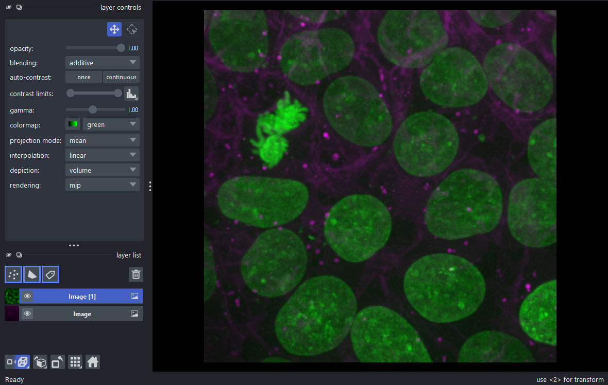

<p align="center">
  
</p>

<p align="center"><b>The napari viewer without the application around it: small, fast, the same API.</b></p>

<p align="center">
  <a href="https://github.com/Aniketsy/napari-lite/actions/workflows/ci.yml"></a>
  
  
  
</p>

<p align="center">
  
</p>

[napari](https://napari.org)'s viewer core as its own package: the seven
layer types in 2D and 3D, napari's rendering, layer list, layer controls,
sliders, key bindings and themes, in a window without menus, plugins or
console. It installs without napari, and the same scripts run after
`import napari_lite as napari`. The code is napari's, copied by a script
from a pinned commit and kept in sync ([how](docs/development.md),
[architecture](docs/architecture.md)); derived from napari under the
BSD-3 licence. Experimental.

## Install

```sh
pip install "napari-lite[pyqt6] @ git+https://github.com/Aniketsy/napari-lite"
```

`pyside6` works in place of `pyqt6`. Python 3.11 to 3.13 on Linux, macOS
and Windows; not on PyPI yet. Extras add what napari needs a package for:
`features` (pandas: feature tables, text and colours by feature, Tracks),
`dask`, `scipy` (spline-interpolated shapes), `tiff`, `fast-shapes`, or
`all`.

## Example

napari's own README example, run with napari-lite. It uses a sample from
scikit-image, which napari-lite does not depend on; any array works the
same way:

```python
from skimage import data
import napari_lite as napari

viewer, layers = napari.imshow(data.cells3d(), channel_axis=1, ndisplay=3)
napari.run()  # start the event loop and show the viewer
```

That script made the window above. Other ways in: `viewer.add_image(array)`
and the other `add_*` methods, `viewer.open('photo.png')`, files dropped
on the canvas or chosen with `Ctrl+O`, a built-in sample with
`viewer.open_sample('napari-lite', 'astronaut')`, and the terminal:
`napari-lite image.png stack.npy` or `napari-lite --sample stent --ndisplay 3`.

## Faster and smaller than napari

Both packages installed with `pip install <package>[pyqt6]` into fresh
environments, napari from the commit the copy was taken from, on one
Windows machine, so read the ratios rather than the seconds.

| | napari-lite | napari | |
|---|---|---|---|
| `import` the package | 0.01 s | 0.22 s | 22x faster |
| first image (`ViewerModel` + `add_image`) | 1.5 s | 3.3 s | 2.2x faster |
| viewer window shown with an image | 3.7 s | 6.0 s | 1.6x faster |
| memory with a window shown | 222 MB | 276 MB | 20% less |
| installed size | 370 MB | 761 MB | 51% less |
| packages installed | 31 | 106 | 71% fewer |
| direct dependencies | 14 | 37 | 62% fewer |

napari-lite is lighter because it imports only what it uses (no xarray
probe on every new layer, no scipy for a thumbnail or a 2D draw, no plugin
discovery, no app-model, no console) and because the heavy packages are
gone or optional: the few functions napari used from scikit-image, scipy,
toolz and wrapt are numpy code, tested against the originals, and pandas
is an extra. What remains, Qt, vispy and the first OpenGL context, is the
same in both, which is why the gap narrows from 22x at import to 1.6x
with a window on screen. How it was measured, and the CI numbers on three
operating systems: [docs/benchmarks.md](docs/benchmarks.md).

## Features

Everything below is napari's code and behaviour, covered by napari's own
tests (copied with the code) and by napari-lite's tests, on Linux, macOS
and Windows without napari installed. The last column is the napari
documentation page for the feature.

| Feature | In napari-lite | Docs |
|---|---|---|
| Viewer | `Viewer`, `imshow`, `run`, `current_viewer`; `show`, `close`, `close_all` | [Viewer](https://napari.org/stable/api/napari.Viewer.html) |
| Layers | `add_image`, `add_labels`, `add_points`, `add_shapes`, `add_surface`, `add_tracks`, `add_vectors`; `viewer.layers`; scale, translate, affine, units, opacity, blending | [Layers guide](https://napari.org/stable/howtos/layers/index.html) |
| Image | 2D and 3D, multiscale, RGB, `channel_axis`, colormaps, contrast limits, gamma, interpolation, volume and plane rendering | [Image](https://napari.org/stable/howtos/layers/image.html) |
| Labels | colour modes, contours; paint, fill, erase, pick, polygon, undo and redo, with mouse and keys | [Labels](https://napari.org/stable/howtos/layers/labels.html) |
| Points | size, symbols, border and face colours, features and text; add, select, move, delete | [Points](https://napari.org/stable/howtos/layers/points.html) |
| Shapes | rectangles, ellipses, lines, paths, polygons, lasso; draw, select, move, edit vertices, copy and paste | [Shapes](https://napari.org/stable/howtos/layers/shapes.html) |
| Surface, Tracks, Vectors | shading, wireframe, normals; graph, tail and head, colour by feature; length, width, colour | [Surface](https://napari.org/stable/howtos/layers/surface.html), [Tracks](https://napari.org/stable/howtos/layers/tracks.html), [Vectors](https://napari.org/stable/howtos/layers/vectors.html) |
| Dims and camera | sliders with playback, 2D/3D toggle, roll, transpose, reset view; `viewer.dims`, `viewer.scene.camera` | [Camera](https://napari.org/stable/guides/camera.html) |
| Mouse and keyboard | pan, zoom, rotate, zoom box, wheel through slices; napari's key bindings ([list](docs/shortcuts.md)); `bind_key`, mouse callbacks | [Key bindings](https://napari.org/stable/gallery/custom_key_bindings.html) |
| Grid and overlays | grid mode; scale bar, axes, text, colorbar, current slice, layer name, bounding box | [Grid mode](https://napari.org/stable/gallery/grid_mode.html), [Overlays](https://napari.org/stable/getting_started/viewer.html#viewer-overlays) |
| Screenshots | `viewer.screenshot`, `export_figure`, `window.clipboard`; `nbscreenshot` in Jupyter | [screenshot](https://napari.org/stable/api/napari.Viewer.html#napari.Viewer.screenshot) |
| Open files and samples | `viewer.open`, drag and drop, `Ctrl+O`: png, jpg, bmp, gif, webp, tif, npy, npz; `open_sample`: imageio's standard images, a CT volume, a computed volume | [Viewer.open](https://napari.org/stable/api/napari.Viewer.html#napari.Viewer.open) |
| Window and `QtCanvas` | napari's layer list, controls and buttons, status bar, `add_dock_widget`; `QtCanvas` puts the canvas and sliders in your own Qt app | [Window](https://napari.org/stable/api/napari.window.Window.html) |
| Settings and themes | napari's settings and defaults, in memory; dark and light themes | [Preferences](https://napari.org/stable/guides/preferences.html) |
| Threads and events | `thread_worker`, `create_worker`, `progress`; napari's events on the viewer, dims, camera and layers | [Threading](https://napari.org/stable/guides/threading.html), [Events](https://napari.org/stable/guides/events_reference.html) |
| dask, zarr, xarray | any array with `shape`, `dtype` and `__getitem__`; dask arrays with the `dask` extra; asynchronous slicing | [Dask and napari](https://napari.org/stable/tutorials/dask.html) |

Data is interpreted exactly as napari interprets it, RGB and multiscale
guessed, the channel axis never ([docs/design.md](docs/design.md)). Where
napari is installed, a test renders every layer type with both packages
and compares the images.

## Not included

Plugins (readers, writers, sample data, widgets), the menus and command
palette, the IPython console, the preferences dialog and settings file,
the welcome screen. `layer.save()` raises `NotImplementedError`; beyond
the built-in reader and samples, load data with your own library and
pass arrays to `add_image`. Planned: a monthly resync with napari's main
branch ([SYNC.md](SYNC.md)) and a PyPI release once the name is settled
with the napari maintainers ([docs/roadmap.md](docs/roadmap.md)).

## More

[Architecture](docs/architecture.md) ·
[How the copy is made](docs/development.md) ·
[Benchmarks](docs/benchmarks.md) ·
[Patches for napari](docs/upstream.md) ·
[Shortcuts](docs/shortcuts.md) ·
[Changelog](CHANGELOG.md) ·
[napari issue 5940](https://github.com/napari/napari/issues/5940)

Derived from napari under the BSD-3 licence; napari's copyright is kept
in [LICENSE](LICENSE).
